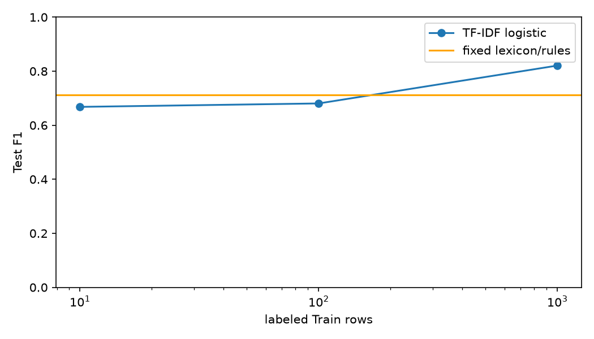

# 규칙 기반 정보 추출과 감성 분석

Python `re`로 이메일/전화/날짜/금액/URL을 추출하고, 직접 구현한 사전 점수와 문맥 규칙을 비교합니다. 식별자 마스킹, 라벨 수별 TF-IDF 비교와 Aspect 분석을 포함합니다.

## 실행 환경과 자료

Python 3.12.14의 전용 venv에서 실행했습니다. 원문 사전은 VADER의 일반 감성 단어 298개를 검토해 사용하며 MIT 저작권을 `licenses/VADER-LICENSE.txt`에 보존했습니다. 직접 점수를 정한 영화 도메인 단어 30개를 `resources/domain-additions.json`에 추가했습니다. 한국어 예시의 대응에는 tasty/expensive의 두 점수도 사용합니다.

정보 추출은 직접 작성한 기본 50문장과 범위 도전 8문장입니다. 연락처/식별자/주소는 실제 개인 정보가 아닌 예약 도메인/가상 값으로 작성했습니다. 감성 평가는 A4-1과 동일한 Polarity2.0 정제 리뷰 2,000개/고정 Test 400개를 사용합니다. 원문/라이선스와 정제 기준은 `resources/sources.json`, `licenses/movie_reviews.xml`과 준비 코드에 있습니다.

## 정규식과 정규화

각 패턴의 의도/매칭 범위는 `extract.py`에 주석으로 기록했습니다.

| 종류 | 처리 범위와 정규화 |
|---|---|
| 이메일 | ASCII local-part, 하위 도메인, 점/별칭. 도메인만 소문자로 변환 |
| 전화 | 010/02/031 등 국내 접두어, 공백/점/하이픈과 +82. 국내 하이픈 형식으로 통일 |
| 날짜 | 연-월-일, 슬래시/점/한국어 구분자. 달력을 검증하고 YYYY-MM-DD 반환 |
| 금액 | 원/억/만/천의 합성과 달러 기호/코드/한국어 표기. Decimal로 계산 |
| URL | http/https, 경로/쿼리/fragment/포트. 문장 끝 구두점과 과도한 닫는 괄호를 정리 |

금액은 통화를 섞지 않습니다. KRW는 원 단위 정수, USD는 센트 단위 정수와 통화 코드를 반환합니다. 따라서 1억 2천만원은 KRW 120000000, $100은 USD 10000센트, $12.50은 USD 1250센트입니다. 환율 변환을 수행하지 않습니다.

```python
from extract import extract
extract("2024년 1월 15일, 1억 2천만원, +82-10-0000-1001")
```

## 추출 성능과 범위 밖 실패

종류와 정규화 값의 다중집합을 직접 작성한 정답과 비교합니다. 같은 값이 반복되는 경우도 개수로 세며, 틀린 정규화는 FP/FN으로 남깁니다.

| 종류 | TP | FP | FN | Precision | Recall |
|---|---:|---:|---:|---:|---:|
| email | 10 | 0 | 2 | 1.0000 | 0.8333 |
| phone | 10 | 0 | 2 | 1.0000 | 0.8333 |
| date | 10 | 0 | 2 | 1.0000 | 0.8333 |
| money | 10 | 0 | 1 | 1.0000 | 0.9091 |
| url | 10 | 0 | 1 | 1.0000 | 0.9091 |

각 종류의 기본 10개씩 총 50문장은 일치했습니다. 범위 도전 8개를 포함한 전체 결과는 `outputs/extraction.json`에 있습니다.

| 실패 | 유형과 원인 |
|---|---|
| 이름@예시.한국 | Unicode 이메일을 ASCII 패턴이 처리하지 않음 |
| "first last"@example.test | 인용 local-part의 공백/따옴표가 현재 범위 밖 |
| 010(0000)1006 | 괄호 구분자를 전화 정규식에 포함하지 않음 |
| +1-202-555-0100 | 국내/+82 접두어 규칙만 있어 해외 번호 누락 |
| Jan 15, 2024 | 영문 월 이름을 숫자로 매핑하는 별도 규칙이 없음 |
| 15/01/2024 | 일-월-연도 순서가 현재 연도 우선 형식과 다름 |
| 삼만원 | 아라비아 숫자와 단위 조합만 계산하므로 한글 수사 누락 |
| www.example.test/path | 명시적인 http/https 스킴이 없어 누락 |

정의한 좁은 범위에서 정밀도가 높았지만, 표현을 늘리면 규칙과 충돌/유효성 검사가 함께 늘어납니다. 국가별 전화/국제화 이메일/날짜 언어를 포괄하려면 별도 파서와 명확한 범위가 필요합니다.

## 마스킹

주민번호 모양, 16자리 카드, 시/구/도로명/건물번호 형태를 추가하고 이메일/전화와 함께 가립니다. 겹치는 구간은 긴 식별자부터 처리해 중복 치환을 막습니다. 형식 기반으로 의심 문자열을 가리는 기능이며 실제 발급/체크섬을 확인하는 기능은 아닙니다.

```text
[RESIDENT] / [CARD] / [ADDRESS] / [EMAIL] / [PHONE]
```

## 감성 점수와 규칙

기본 점수는 단어별 valence 합입니다. 문맥 규칙은 같은 절의 앞 3토큰에서 부정어를 세어 홀수면 부호를 반전하고, very/really/extremely 등의 배수를 적용합니다. not not good은 두 번 부정되어 양의 점수가 됩니다. UNK의 위치를 유지하므로 정제에서 단어가 사라져 부정어 거리가 임의로 짧아지지 않습니다.

but/however에서는 부정 범위를 끊고 역접 전후의 가중치를 달리합니다. 한국어는 좋지 않다/매우 좋다/안 좋지 않다 등 명시한 작은 패턴만 대응하며 범용 형태소 분석기로 제시하지 않습니다. 문자열 안의 '안' 음절을 무조건 부정어로 바꾸지 않습니다.

## 고정 Test 감성 평가

A4-1과 같은 층화 Train 1,600 / Test 400을 사용했습니다. Test는 긍정/부정 각 200개이며 규칙이나 임계값을 Test에 맞춰 학습하지 않았습니다. 사전 합계가 0보다 크면 긍정, 나머지는 부정으로 분류합니다. F1은 긍정 클래스 기준이며 Macro F1을 함께 기록합니다.

| 방식 | Accuracy | 긍정 F1 | Macro F1 |
|---|---:|---:|---:|
| base_dictionary | 0.5975 | 0.7035 | 0.5385 |
| domain_dictionary | 0.5975 | 0.7035 | 0.5385 |
| context_rules | 0.6200 | 0.7132 | 0.5751 |

문맥 규칙 후 Accuracy는 59.75%에서 62.00%, 긍정 F1은 0.7035에서 0.7132로 변했습니다. 도메인 30단어의 추가만으로 분류 결과가 좋아졌다고 주장하지 않습니다. 전체 문장에는 긍정 표현이 많이 남아 있어, 문맥 규칙도 부정 200개 중 141개를 긍정으로 오분류했습니다. 부정 재현율은 29.5%로 낮으며 긍정 F1만 보면 이 편향을 놓칠 수 있습니다.

## 실제 오분류 10건 검토

저장한 실제 규칙 오분류 15건 중 다음 10건의 정제 문장과 강한 기여 단어를 확인했습니다. 이름 등을 가린 표현이므로 의미 손실도 함께 고려했습니다.

| 문서 | 실제/예측 | 관찰과 원인 |
|---|---|---|
| review-0020 | 부정/긍정 | worst와 brilliant/wonderful이 공존해 최상급 단어의 합만으로 평가 범위를 구분하지 못함 |
| review-0466 | 부정/긍정 | enjoy/successful이 반복되며 기대나 서술의 대상과 작품 전체의 평가를 분리하지 못함 |
| review-0484 | 부정/긍정 | good/bad/love가 섞이고 bad가 부정 범위에 걸려 양의 기여로 바뀌는 경우도 있음 |
| review-1525 | 긍정/부정 | sad/anger/sorrow/violent 같은 줄거리의 정서와 작품의 품질 평가가 혼동됨 |
| review-0105 | 부정/긍정 | not very good과 enjoy 주변의 긴 부정 범위를 단순 3토큰 창으로 포괄하지 못함 |
| review-0230 | 부정/긍정 | 원작/과거 감상에 대한 great/romantic/liked가 현재 작품의 평가와 함께 합산됨 |
| review-0339 | 부정/긍정 | bad horror와 entertaining/better가 섞인 장르/비교 평가를 분리하지 못함 |
| review-0782 | 부정/긍정 | evil/villain의 인물 표현과 joyous/magnificent 같은 표현이 동일 점수로 합산됨 |
| review-0004 | 부정/긍정 | bad가 부정어의 좁은 창에 걸려 양의 기여가 되지만 문장 전체의 부정 평가를 담지 못함 |
| review-0772 | 부정/긍정 | really bad/poor와 fun/funny 및 disaster movie의 장르 표현이 뒤섞임 |

이 오류는 단어의 사전 극성만으로 주체/인용/비교/반어와 긴 부정 범위를 결정하기 어렵다는 것을 보여줍니다. 원인 설명은 관찰 가능한 문구에 대한 해석이며 모든 오류의 인과적 원인을 확정한 것은 아닙니다. 실제 점수와 상위 기여는 `outputs/sentiment.json`에 있습니다.

## 라벨 수에 따른 통계 방법과 비교

같은 Test 400개를 유지하고 Train 풀에서 클래스별 같은 수로 10/100/1,000개를 골랐습니다. 각 TF-IDF의 어휘/IDF와 LogisticRegression은 해당 Train에서만 fit했습니다. 규칙/사전은 라벨 수마다 바꾸지 않았습니다.

| 라벨 Train 수 | TF-IDF Accuracy | TF-IDF 긍정 F1 | TF-IDF Macro F1 | 고정 규칙 Accuracy | 고정 규칙 긍정 F1 |
|---|---:|---:|---:|---:|---:|
| 10 | 0.5850 | 0.6680 | 0.5573 | 0.6200 | 0.7132 |
| 100 | 0.6975 | 0.6807 | 0.6967 | 0.6200 | 0.7132 |
| 1000 | 0.8200 | 0.8209 | 0.8200 | 0.6200 | 0.7132 |



10개에서는 사전의 사전 지식이 유리했지만 1,000개에서는 TF-IDF가 더 높은 성능을 냈습니다. 100개일 때는 TF-IDF의 Accuracy/Macro F1이 더 높고 긍정 F1은 낮았습니다. 한 클래스의 F1만으로 두 방법의 우열을 단정하지 않습니다. 규칙은 도메인 문구를 명시하기 쉽지만, 라벨이 늘어날 때 새로운 표현의 가중치를 통계적으로 학습하는 장점이 있습니다.

## Aspect별 분석

감성 단어를 같은 절의 5토큰 안에 있는 가까운 Aspect에 연결합니다. story/acting/visual/sound와 예시 food/price를 구분하며 역접/문장 경계를 넘어 붙이지 않습니다.

| 실제 입력 | 결과 |
|---|---|
| The story is excellent but the acting is terrible. | story +1.35 / acting -3.15 |
| The music is wonderful. The visual effects are awful. | sound +2.70 / visual -2.00 |
| 음식은 매우 좋다. 가격은 비싸다. | food +2.85 / price -1.50 |

가까운 명사에 붙이는 규칙이므로 대명사/원거리 의존과 하나의 형용사가 여러 대상을 수식하는 경우에는 별도 검증이 필요합니다. 이 세 예시와 8개 독립 검사는 기능 확인이며, 별도 Aspect 레이블 코퍼스의 성능을 측정한 것은 아닙니다.

## 설치와 실행

```bash
python3.12 -m venv .venv
source .venv/bin/activate
python -m pip install -r requirements.txt
python prepare_data.py --download
python -m unittest discover -s tests -v
python evaluate.py extraction
python evaluate.py sentiment
```

prepare_data는 고정 원본/정제 해시와 A4-1의 분할을 연결하므로 원본 연락처/이름을 평가 입력에 넣지 않습니다. 정제 리뷰 2,000개는 A4-1과 바이트 단위로 일치했습니다. 추출 문장/정답, 사전과 도메인 추가는 저장소에서 직접 확인할 수 있습니다. 원시 리뷰와 다운로드 캐시는 `data/`에 두고 Git에서 제외합니다.
